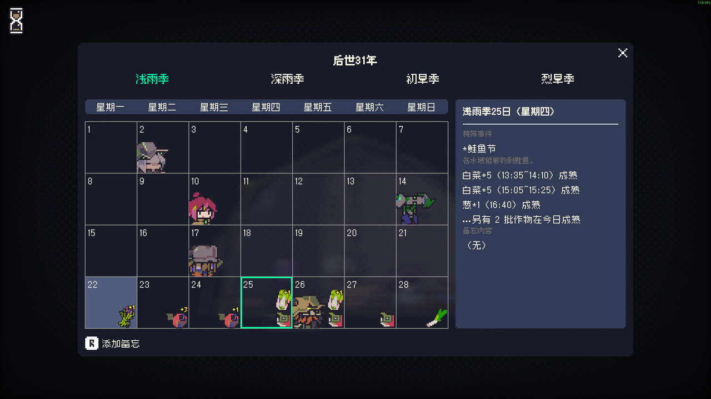
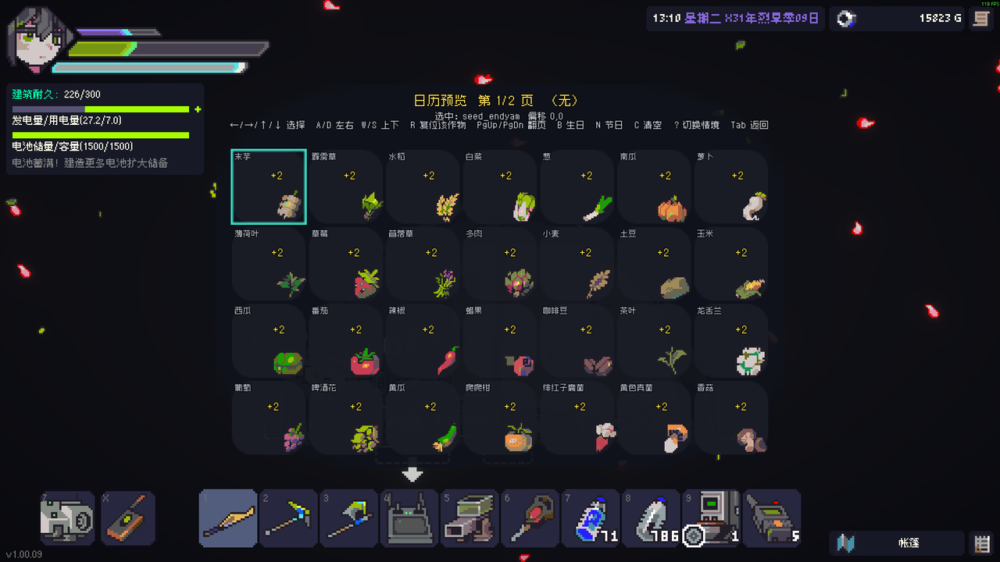

# 多洛可日常信息增强 / Doloc Daily Info Enhanced

《多洛可小镇》（Doloc Town）的功能性模组：把「今天有什么要紧事」直接摊在日历和时钟下面——作物什么时候熟、谁过生日、今天什么节日、游商来没来、农场的塑料薄膜还够不够用。

作者：**左舷笙 & 大肥鱼（deepseek）** ｜ 依赖前置模组：**DTMAPI**（工坊 id `3743016467`，最低 0.6.0，实测 0.7.0 / 0.7.6）
最后更新：游戏 v1.00.09 ｜ 模组版本 v1.9.9


## 功能

### 1. 作物成熟日期预测



- 按每株作物**当前**的生长值与生长速率线性外推成熟时刻（优先用游戏内实测的上一刻生长量，所以肥料、补光灯、基因、房间效果都会自动计入），不预判阶段变化。
- **日历**：当天会成熟的作物在日期格里显示作物图标；当天有两种及以上作物成熟时，图标右上角显示 `+N`。
- **点开某一天**，右侧「特殊事件」在原有生日/节日之后追加，每种作物一行，时间并入标题：
  - `伊甸果*1（09:15）成熟`
  - `龙舌兰*2（15:45~15:50）成熟`
  - 已成熟但没收割：`白菜*3已成熟待收割`
  - 行数按面板剩余高度**自动计算**，不会压住下面的「备忘内容」；超出的折成 `…另有 N 批作物在今日成熟`。
- 同种作物相差不超过「同批判定阈值」（默认 60 分钟）算一批；时间按 5 分钟向上取整（与游戏内时间一致），可切换为显示真实分钟。
- **主界面**：时钟下方悬挂当天最早成熟的作物图标；成熟（可收割）时外框出现一圈脉冲的黄色描边；收割后图标消失、`+N` 数字减少。
- 悬停图标可看到 `作物名 x数量 已成熟（还有 N 种作物）`，未成熟时显示预计成熟时间。
- 已成熟未收割的作物，之后每天继续提醒（只占当天一行）。
- **建筑内的作物也计入，且不需要先进去一次**：会枚举主农场、独立农场、全部城镇房间以及它们内部的建筑房间（温室、大棚等）。
- **立木架里的树（可可树）同样计入**：按游戏为每棵树随机生成的每级成长目标逐级累加，落点与游戏一致；名字和图标取成熟掉落物（可可果）。
- 推算正好落在 24:00 的作物算**当天**，显示 `24:00 成熟`（游戏时钟跨过零点后才变成次日），不会在两天之间跳。

### 2. 角色生日与节日提醒

- 当天有可送礼角色生日时，时钟下方悬挂头像（可带小爱心）。
- 送出礼物后当天头像消失（读档后也不再出现）。
- 节日同样悬挂图标，顺序排在作物之后。
- **节日参与时间高亮**：长夜节第 4 天与最后一天（烈旱季 25、28 日）18:00-24:00、蘑菇节最后一天（深雨季 18 日）9:00-18:00，当天节日角标的边框会脉冲闪动，提示该时段有活动要到场。

### 3. 游商到来提醒

- 莉卡，以及尚未入驻商埠的夏洛克 / 帕伊雅 / 奇普 / 凯涅尼木来到小镇时悬挂头像。
- 已入驻商埠的游商不再提醒。
- 达到入驻标准但还没入驻时常驻提醒并高亮，悬停显示「<角色名>可以入驻商埠了！」。
- **商埠开放（主线「河道疏通」完成）之前不会提示这三位商埠游商**。
- 与游商对话后当天该提醒消失（一开口就算；打开莉卡的商店再退出也算）。
- **长夜节最后三天（烈旱季 26/27/28）不再提示莉卡来到小镇**——那三天她在镇上经营长夜集市，不是游商摊位。
- 主线「旧城市废墟 · 和派克聊聊」期间，派克**只在到来的那一天**提示并高亮；当天不对话，第二天就不再打扰，谈完话即消失。

### 4. 塑料薄膜耐久提醒

- 农场地面上的种植盆，只要有一张塑料薄膜剩余时间低于 **20 小时**，就在时钟下方悬挂薄膜图标（排在作物之后、节日之前）。
- 悬停文案：单个农场「农场的塑料薄膜耐久度低于20小时。」；多个农场「农场、湿地农场的塑料薄膜耐久度低于20小时。」
- 只报「哪个农场」，不报数量与具体盆位；温室 / 集装箱 / 地窖等建筑内部的盆不计入。
- 剩余时间按薄膜点数换算（1 点 = 1 个时间单位 = 5 游戏分钟，一张新膜 576 点 = 整整两天），**不参考耐久条**——耐久条把 240 点当满格是游戏的显示问题。

### 5. 树脂收集器

空置时主动让出与植株重叠时的互动优先级。

## 安装

1. 先装前置模组 **DTMAPI**（创意工坊）。
2. 直接在 Steam 创意工坊订阅该模组。
2.1. 手动安装：把 `SomeOptimizations` 文件夹放进：

```
C:\Users\<用户名>\AppData\LocalLow\RedSawGames\DolocTown\MODS\
```

3. 在游戏的「模组」页面启用，重启游戏。

> UniqueID 是 `SomeOptimizations`，**不要改**（改了存档会认为换了一个模组）。

## 配置

全部功能都能在 DTMAPI 的模组设置里单独开关（标题界面 → DTMAPI 设置 → 多洛可日常信息增强）：

- 作物：显示具体成熟时间 / 同批判定阈值 / 关闭成熟时的图标高亮 / 关闭立木架（可可树）的成熟提醒 / 悬挂图标背景颜色
- 生日与节日：满好感度角色仍显示生日提醒 / 生日提醒不显示小爱心 / 关闭特定节日参与时间提醒（都默认关）
- 游商：关闭特殊情况下的派克提醒 / 关闭莉卡到来的提醒 / 关闭长夜节时莉卡到来的提醒 / 关闭商埠游商到来的提醒 / 关闭游商可入驻商埠的提醒
- 农场维护：关闭塑料薄膜耐久提醒
- 其他：恢复树脂收集器的互动优先级 / 记录诊断日志（排障用） / 开启布局编辑器（默认 F7 打开、默认关闭）

生成的配置文件在 `DTMAPI\config\SomeOptimizations.json` 与 `SomeOptimizations.state.json`；**不碰存档**，卸载后不会有缺模组报错或错误道具。

## 布局编辑器（可选）



按 `F7` 打开数值页，`Tab` 切到日历预览（自绘 7×4 网格，28 种作物一页）：
`←/→/↑/↓` 选格、`A/D`/`W/S` 微调、`R` 复位、`PgUp/PgDn` 翻页、`B` 轮换生日角色、`N` 轮换节日、`C` 清空、`空格` 切情境、`F9` 保存。

## 从源码构建

要求：Windows + .NET SDK 8，本机装了《多洛可小镇》与 DTMAPI（编译需要游戏的 `Assembly-CSharp.dll` 等和 `DTMAPI.Abstractions.dll`）。

```bat
cd src
copy game.path.example game.path       :: 改成你的游戏目录，例如 D:\SteamLibrary\steamapps\common\Doloc Town
dotnet build -c Release
```

产物 `src\bin\Release\SomeOptimizations.dll`，覆盖到：

```
%LocalAppData%Low\RedSawGames\DolocTown\MODS\SomeOptimizations\Content\DTMAPI\SomeOptimizations.dll
```

也可以不改 `game.path`，直接用 `dotnet build -c Release -p:GameDir="D:\...\Doloc Town"`，或设环境变量 `DOLOC_GAME_DIR`。

## 源码导读

| 文件 | 作用 |
| --- | --- |
| `ModEntry.cs` | 入口：Harmony 装载、事件订阅 |
| `ModConfig.cs` / `Settings.cs` | DTMAPI 配置项 |
| `Layout.cs` | 所有可调版面参数 + 逐作物偏移 |
| `ModState.cs` | `state.json` 读写（送礼/对话记录、逐作物偏移） |
| `CropScan.cs` | **农场扫描与成熟时间预测（核心算法）** |
| `GameTime.cs` | 游戏时间与取整 |
| `Reminders.cs` | 徽章构建：派克 / 生日 / 游商 / 作物 / 薄膜 / 节日 |
| `Festivals.cs` | 节日日期区间与提醒时段（长夜节 / 蘑菇节） |
| `FilmScan.cs` | 塑料薄膜剩余时间扫描（按农场） |
| `HudBadges.cs` | 时钟下方的悬挂图标行 |
| `CalendarInject.cs` | 日历格子图标 + 右侧特殊事件行 |
| `PreviewUi.cs` | 日历微调的预览面板（自绘 7×4） |
| `EditorUi.cs` | 布局编辑器（F7 / Tab） |
| `UiFactory.cs` | 程序化贴图与图标裁边（`IconFit`） |
| `UiRoot.cs` | UI 宿主 Canvas |
| `Tracking.cs` | 送礼 / 对话的当日记录 |
| `ResinPriority.cs` | 树脂收集器互动优先级 |
| `CropDefaults.cs` | 逐作物微调的内置默认值 |

## 已知可改进的地方

1. 预览面板里植物背景的 UI 做成和日历一致、`+N` 回到正常位置（v1.6 时是正确的）。
2. 编辑器界面美化。
3. 编辑器改用鼠标操作而不是键盘。
4. 性能：`CropScan` 目前每秒重建一次全部农场的快照，可能有优化空间（未确认）。
5. 文案/介绍的润色。
6. 优化作物成熟日期预测中可能存在的针对建筑物内作物以及施肥作物以及前二者叠加情况下的预测。

## 更新日志

### v1.9.9
- 修：商埠没开（「河道疏通」未完成）时，夏洛克 / 帕伊雅 / 奇普不再提示「来到了小镇」。根因是判断到访时只读了配置表日程，没看该 NPC 的日程有没有被剧情启用。
- 修：商埠没修好时不再提示「可以入驻商埠了」，并补上「已认识联络人」「联络未被关闭」两个前置。

### v1.9.8
- 新增：**塑料薄膜耐久提醒**。农场（农场 / 旧城农场 / 湿地农场）里有薄膜剩余时间低于 20 小时时，时钟下方悬挂薄膜图标，悬停显示是哪几个农场；只算农场地面上的盆，温室/集装箱/地窖内的不算；不看耐久条（那是显示 bug），按点数换算真实剩余时间（1 点 = 5 游戏分钟）。

### v1.9.7
- 修：**24:00 闪烁仍在**（v1.9.6 的容差只有 ±0.5 分钟）。时钟按 5 分钟一格跳、作物 tick 与时钟是两次独立更新、最后一档成长用除法外推——三者都会让「24:00」上下浮动一两分钟，一旦跨过零点就被判成第二天。改为按游戏自己的 5 分钟刻度取整，并把零点后头 5 分钟也归前一天：落在这条 10 分钟带子里就稳定显示「当天 24:00」。
- 改：节日高亮收窄为长夜节第 4 天与最后一天（25、28 日）18:00-24:00。
- 修：派克提醒不再跨天常驻，只在他到来的那天提示并高亮；谈完话清零。
- 新增：设置项「记录诊断日志（排障用）」。

### v1.9.6
- 修：**24:00 成熟的作物会一闪一闪、并从今日/次日列表里彻底消失**。日期分桶直接对浮点分钟取 `floor`，24:00 的推算值在 `35999.99998 / 36000.00002` 之间摆动，这一条就在「今天」与「明天」两个桶之间来回跳；跨零点后落在「昨天」的那份被当成过期数据丢弃，两天都看不到。现在先取整到整分钟再分桶，24:00 归当天并显示为 `24:00`；落在过去的样本并入当天而不是丢弃。
- 新增：**立木架（可可树）成熟提醒**。立木架里的树原先整类被跳过；现在按游戏为每棵树随机生成的每级成长目标精确推算，名称与图标取成熟掉落物（可可果）。
- 修：**与莉卡对话后选「进入商店」再退出不再残留提醒**。对话一开始就记为已见面；打开莉卡的商店（含长夜集市那家）也算。
- 新增：**长夜节最后三天（烈旱季 26/27/28）撤掉「莉卡来到了小镇」提醒**（她在镇上经营长夜集市，不是游商摊位）。
- 新增：**节日参与时间高亮**：长夜节第 4 天起 18:00-24:00、蘑菇节最后一天 9:00-18:00，节日角标边框脉冲。

### v1.9.5
- 修：跨过零点后，昨天成熟但没收割的作物不再从日历 / 提醒里消失（此前要小退重进才恢复）。
- 改：悬停文案改为「作物名 x数量 已成熟（还有 N 种作物）」，数量只算这一批，不再混入当天其他作物。
- 改：设置项改名为「满好感度角色仍显示生日提醒」「生日提醒不显示小爱心」，两者默认关。

### v1.9.4
- 改：DTMAPI 设置里的模组名改为读取 `info.json`，不再写死。

### v1.8.0
- 改：日历微调界面改为自绘网格（不再借用游戏日历面板）。

## 其它

- DLL 没有加密、没有混淆。用 ILSpy / dnSpy 能看到接近原文的 C#，但注释不会保留，改代码建议用本仓库源码。
- 这个 DLL 会在每个玩家机器上执行：**不要在里面加任何上传、联网、删文件的逻辑**。
- 卸载模组不会破坏存档。

## 授权

作者原话：只要**标明原模组**（作者「左舷笙&大肥鱼（deepseek）」并链回本仓库或创意工坊页面），可以随意修改、上传改良版，包括作为新 MOD 发布。
